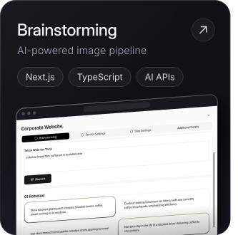
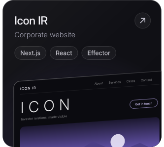
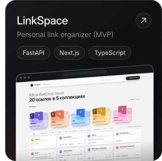
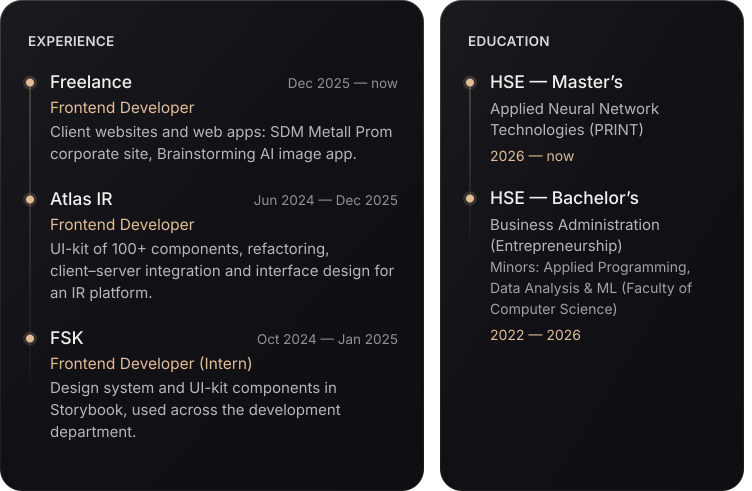

<!-- Generated by tools/build.py from tools/content.json — edit the JSON, not this file. -->

Text version

**Alina Pipchenkova** — Frontend Developer. I build interfaces from idea to production — with a strong focus on design, performance and AI.  
Open to work — frontend (remote / hybrid, Moscow)

[Telegram](https://t.me/pip_ch) · [Email](mailto:pipchenkova0701@gmail.com) · [Portfolio](https://pipchenkovaa.github.io/businessCard/)

**About.** I’m a frontend developer with 2+ years of commercial experience, passionate about creating thoughtful, user-focused interfaces. I work across the full frontend cycle — from Figma and design systems to API integration and production. Currently doing my Master’s at HSE (Applied Neural Network Technologies) and exploring the intersection of frontend, product design and AI.

**Stack.** Core: React, Next.js, TypeScript, JavaScript, Effector; UI & Motion: Tailwind, Framer Motion, shadcn/ui, GSAP, Three.js; Tools: Vite, Git, Docker, Vercel, Figma; Also: Python, FastAPI

**Projects.**

- [Brainstorming](https://brainstorming-beryl.vercel.app) — AI-powered image pipeline (Next.js, TypeScript, AI APIs)
- Icon IR — Corporate website (Next.js, React, Effector)
- LinkSpace — Personal link organizer (MVP) (FastAPI, Next.js, TypeScript)

**Experience.**

- Freelance — Frontend Developer, Dec 2025 — now. Client websites and web apps: SDM Metall Prom corporate site, Brainstorming AI image app.
- Atlas IR — Frontend Developer, Jun 2024 — Dec 2025. UI-kit of 100+ components, refactoring, client–server integration and interface design for an IR platform.
- FSK — Frontend Developer (Intern), Oct 2024 — Jan 2025. Design system and UI-kit components in Storybook, used across the development department.

**Education.**

- HSE — Master’s — Applied Neural Network Technologies (PRINT), 2026 — now
- HSE — Bachelor’s — Business Administration (Entrepreneurship); Minors: Applied Programming, Data Analysis & ML (Faculty of Computer Science), 2022 — 2026

